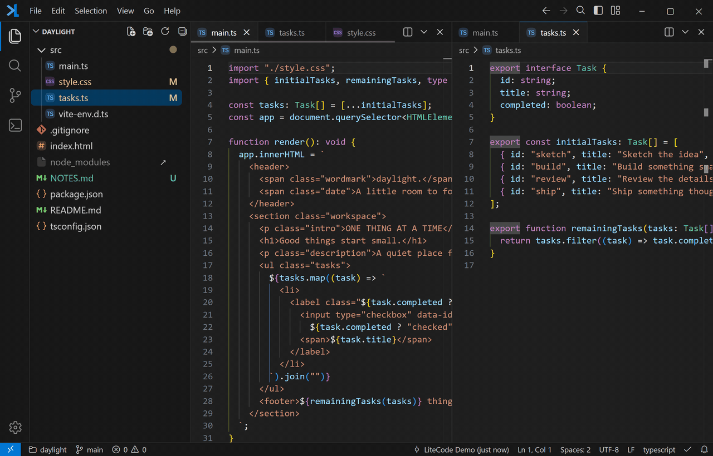

#  LiteCode

A lightweight, open-source VS Code alternative built with Tauri.

**Website:** [litecode.tingyuan.in](https://litecode.tingyuan.in/en/) · **Download:** [GitHub Releases](https://github.com/lovetingyuan/litecode/releases)

## Why LiteCode

In the age of AI coding, a lightweight editor still has a place. LiteCode keeps the familiar feel of VS Code and the essentials close at hand, so you can open a local project, understand generated code, review changes, and refine the details yourself.

## Main features

- File and folder management, quick open, and full-text search and replace.
- Tabbed editing, split views, a command palette, and custom keyboard shortcuts.
- Syntax highlighting, code completion, navigation, diagnostics, and formatting.
- Integrated terminals with multiple tabs and split panes.
- Git source control, diff views, staging, and commits.
- Live Markdown preview, plus image, audio, and video previews.

The Windows installer adds **Open with LiteCode** to the File Explorer menus for files, folders, and folder backgrounds. Each action opens a separate window. On Windows 11, select **Show more options** to find it. Uninstalling removes the menu; portable builds do not register it.

## Tech stack

Built with Tauri 2 and Rust, React and TypeScript, Monaco Editor, and xterm.js.

---

_Write by GPT._
