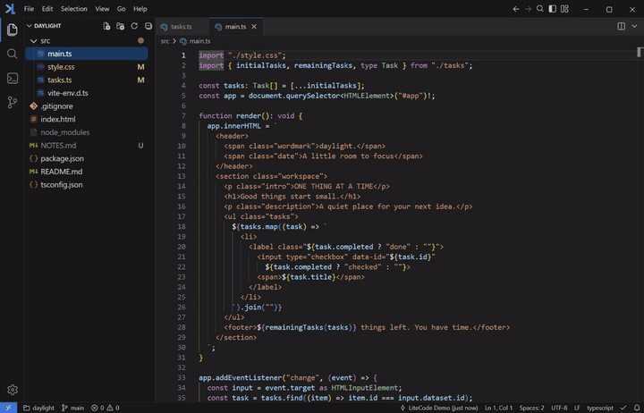

#  LiteCode

[Watch the feature demo (MP4)](docs/images/demo.mp4)

## Why LiteCode

In the age of AI coding, a lightweight editor still has a place. LiteCode keeps the familiar feel of VS Code and the essentials close at hand, so you can open a local project, understand generated code, review changes, and refine the details yourself.

## Main features

- File and folder management, quick open, and full-text search and replace.
- Tabbed editing, split views, a command palette, and custom keyboard shortcuts.
- Syntax highlighting, code completion, navigation, diagnostics, and formatting.
- Integrated terminals with multiple tabs and split panes.
- Git source control, diff views, staging, and commits.
- Live Markdown preview, plus image, audio, and video previews.

The Windows installer adds **Open with LiteCode** to the File Explorer menus for files, folders, and folder backgrounds. Each action opens a separate window. On Windows 11, select **Show more options** to find it. Uninstalling removes the menu; portable builds do not register it.

## Tech stack

Built with Tauri 2 and Rust, React and TypeScript, Monaco Editor, and xterm.js.

## Development commands

Run `npm ci` first. Desktop development requires Node.js 24+, Rust, and the Windows build tools.

| Command                  | Purpose                                                                        |
| ------------------------ | ------------------------------------------------------------------------------ |
| `npm run tauri -- dev`   | Start the desktop app and Vite dev server.                                     |
| `npm run tauri -- build` | Build the desktop installer.                                                   |
| `npm run dev`            | Start only the frontend dev server.                                            |
| `npm run build`          | Type-check and build the frontend.                                             |
| `npm run lint`           | Lint; add `-- --fix` to apply fixes.                                           |
| `npm run format`         | Format files with Oxfmt, excluding generated language tools.                   |
| `npm test`               | Run unit tests.                                                                |
| `npm run test:e2e`       | Run desktop verification with the debug app built and Vite running.            |
| `npm run release`        | Run the signed release workflow; see [release instructions](docs/releases.md). |

`build:tools` packages the Web, TypeScript, and Vue language services and the Oxfmt npm formatter, including its HTML support. Tauri runs it automatically before development and builds; run `npm run build:tools` manually when rebuilding tools for a direct Cargo build. `postinstall` applies the required Trees scroll patch automatically after installing dependencies.

HTML and Markdown support document formatting and `editor.formatOnSave` through bundled Oxfmt. A compatible Node.js installation is required; Prettier and Language Tools do not need to be installed separately unless selected by project configuration. Markdown formatting collapses extra blank lines between paragraphs while preserving necessary spacing and literal code-block content.

Debug builds use the `dev` subdirectory of the normal application data directory, so the development app and installed release can run together with separate settings and recovery sessions. Each data directory retains its own single-instance protection. An existing `data` directory beside the executable still takes precedence for portable mode.

Specialized checks run directly: `node tools/verify-languages.mjs` after packaging language tools, `node tools/verify-vue.mjs` with the debug app built and Vite running, and `node tools/verify-updates-desktop.mjs` after `npm run build`. See [language verification](docs/verification/LANGUAGE_CAPABILITIES.md) and [update verification](docs/releases.md#verification).
