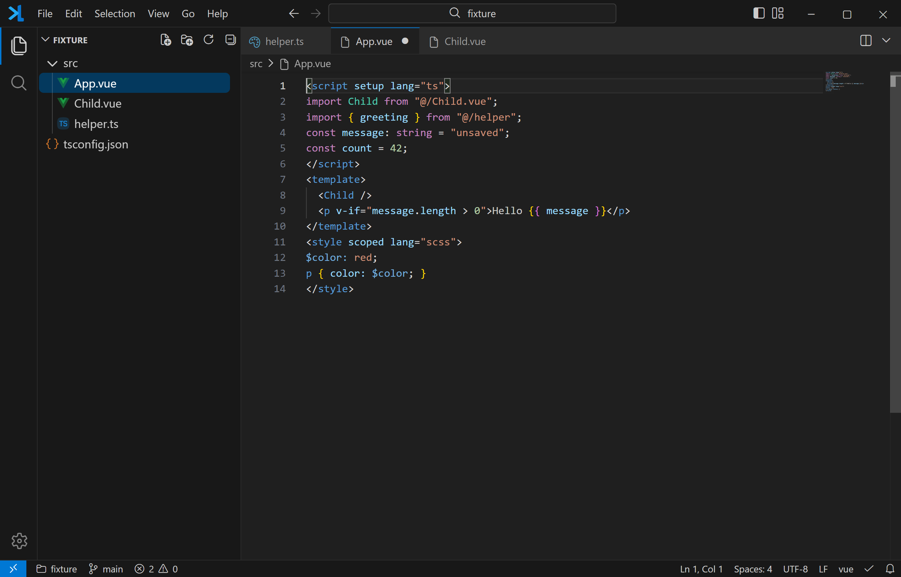

#  LiteCode

LiteCode is a local code editor for Windows 11, built with Tauri, React, and Monaco, with a dark interface inspired by VS Code.

- File and folder management, quick open, and full-text search and replace.
- Tabbed editing, split views, a command palette, and custom keyboard shortcuts.
- [Integrated terminals](docs/terminal.md) with independent tabs, nested split panes, and live settings.
- Syntax highlighting, code completion, navigation, diagnostics, and formatting.
- Live Markdown preview, plus image, audio, and video previews.
- User and workspace settings, session restoration, and backups of unsaved changes.

Open **Preferences: Open User Settings (JSON)** to see supported settings with descriptions and defaults. Settings are grouped and sorted when opened; comments and custom values are preserved. Workspace `.litecode/settings.json` files are also organized when opened, without adding defaults. Saving does not reorder settings.

Launching LiteCode again with the same user data directory activates the existing window. Portable copies with separate `data` directories can run independently.

**Help → Check for Updates…** checks the latest official GitHub release. Installed editions can download and install signed updates in the app; startup checks show an update button without interrupting your work. See [local release and signing instructions](docs/releases.md) for `npm run release`.

Interrupted workspace replacements are detected on startup. **Search: Recover Interrupted Replacements** lets you restore an operation's starting state or keep current contents; backups are retained, and externally changed files are never overwritten automatically. **Search: Retry Interrupted Replacement** resumes an unfinished operation from the current session.
